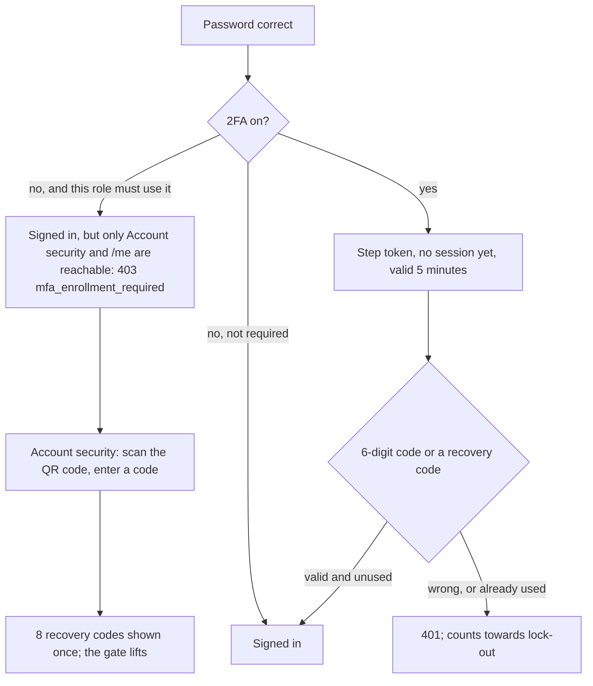
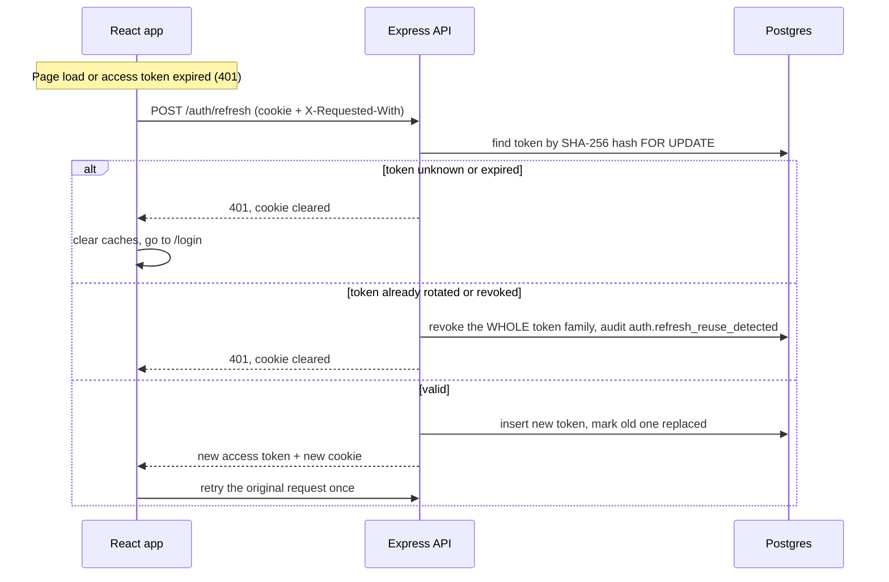
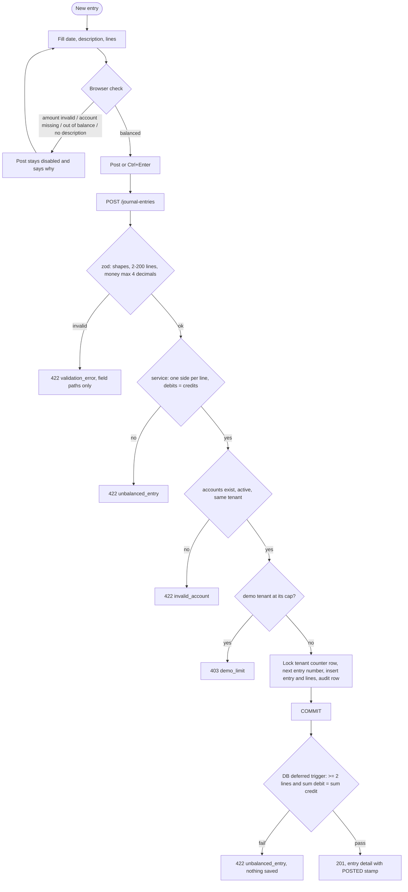
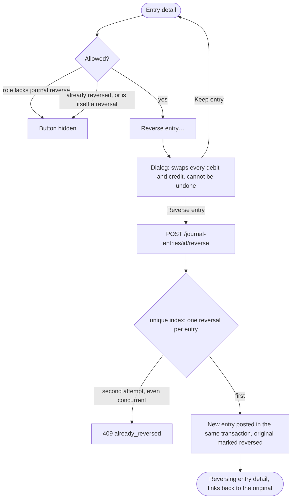
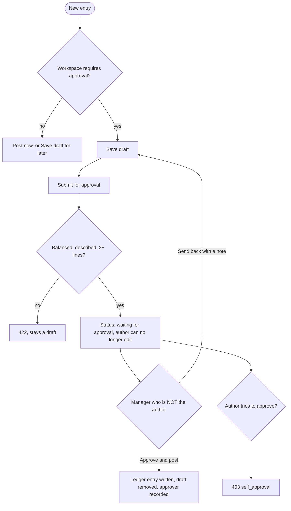
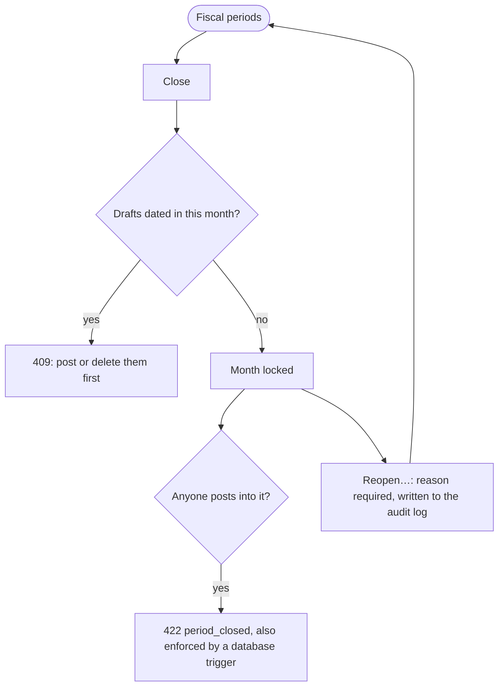
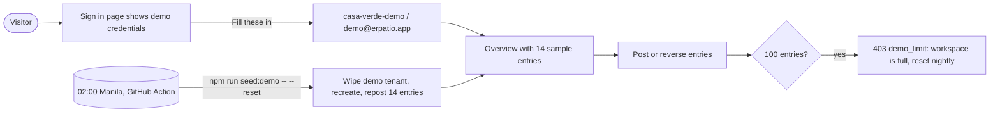
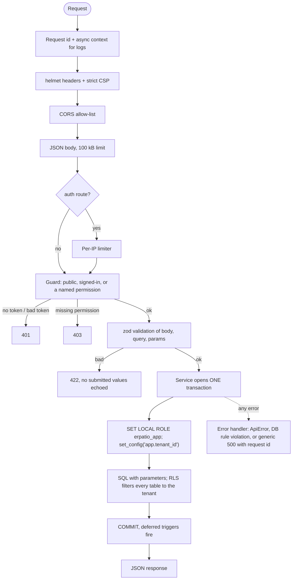
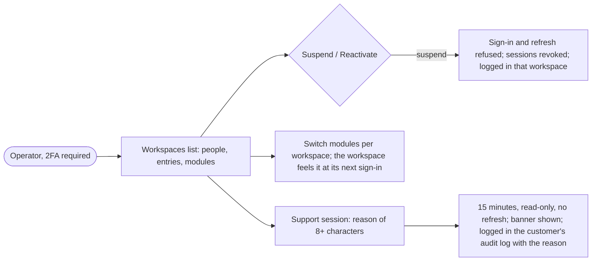

# ERPatio App Flow

How a person moves through the app, and what the system does behind each step.
Everything here matches the code on `feat/m0-foundation-neon-render`. Where a flow is not built yet it is marked **Not built**.
Visual reference: [clickable HTML prototype](design/prototype/erpatio-prototype.html). Look and feel: [UI design system](design/ui-design-system.md).

## 1. Who can do what

Roles are system roles seeded per tenant (`backend/src/lib/permissions.ts`). Permissions travel in the access token.

| Screen / action | Permission | TenantAdmin | FinanceManager | Accountant | DemoUser | Viewer |
|---|---|:-:|:-:|:-:|:-:|:-:|
| Overview, chart of accounts, journal and drafts (read), trial balance, income statement, balance sheet, fiscal periods (read) | `accounts:read` `journal:read` `reports:read` | ✔ | ✔ | ✔ | ✔ | ✔ |
| Add or deactivate an account | `accounts:write` | ✔ | ✔ | ✔ | ✔ | |
| Save a draft, post an entry, submit for approval | `journal:post` | ✔ | ✔ | ✔ | ✔ | |
| Reverse an entry | `journal:reverse` | ✔ | ✔ | ✔ | ✔ | |
| Approve and post, send back | `journal:approve` | ✔ | ✔ | | | |
| Close or reopen a period, add a fiscal year | `periods:manage` | ✔ | ✔ | | | |
| Settings (approval policy) | `settings:manage` | ✔ | ✔ | | | |
| Audit log | `audit:read` | ✔ | ✔ | | ✔ | |
| See people and roles | `users:read` | ✔ | | | | |
| Invite, deactivate, assign roles | `users:manage` | ✔ | | | | |
| Create and edit custom roles | `roles:manage` | ✔ | | | | |
| Export or erase another person's data | `privacy:manage` | ✔ | | | | |

`FinanceManager` is the customer's finance manager (Lea in the profile). The public `DemoUser` cannot approve, close periods or change settings, so visitors cannot lock the demo for each other ([ADR-008](adr/ADR-008-public-demo-workspace.md)).
A route without a declared permission cannot be registered, and the server refuses to start if one slips in (US-124).

## 2. Screen map

```mermaid
flowchart LR
  A([Visitor]) --> L[Sign in]
  L -->|credentials ok| O[Overview]
  L -->|bad credentials / locked| L
  O --> CoA[Chart of accounts]
  O --> J[Journal: Posted | Drafts]
  O --> FP[Fiscal periods]
  O --> R[Reports]
  R --> TB[Trial balance]
  R --> IS[Income statement]
  R --> BS[Balance sheet]
  O --> AU[Audit log]
  O --> ST[Settings]
  J --> N[New entry / Edit draft]
  J --> D[Entry detail]
  J --> DP[Draft page]
  N -->|Post| D
  N -->|Save draft| DP
  N -->|Submit for approval| J
  DP -->|Approve and post| D
  DP -->|Send back| J
  D -->|Reverse…| RV{{Confirm}}
  RV -->|Reverse entry| D2[Reversing entry detail]
  CoA --> AA{{Add account}}
  FP --> CL{{Close / Reopen…}}
  O -->|Sign out| L
```

Navigation rules
- Not signed in: every route except `/login` redirects to `/login`; after sign-in the person returns to the page they asked for.
- Signed in and opening `/login`: redirected to Overview.
- A role without the permission never sees the menu item; opening the URL directly shows "Your role cannot …" and the API answers 403 anyway.

## 3. Sign in

```mermaid
sequenceDiagram
  actor U as Person
  participant W as React app
  participant A as Express API
  participant D as Postgres (RLS)
  U->>W: workspace + email + password
  W->>A: POST /api/v1/auth/login
  A->>A: per-IP rate limit (10/min)
  A->>D: resolve_tenant(slug)  (SECURITY DEFINER, no table access)
  alt unknown workspace or suspended
    A->>A: verify against dummy hash (equal timing)
    A-->>W: 401 invalid_credentials
  else tenant found
    A->>D: BEGIN; SET LOCAL ROLE erpatio_app; set_config(app.tenant_id)
    A->>D: SELECT user FOR UPDATE
    alt unknown user / wrong password / currently locked
      A->>D: failed_attempts++ (lock 15 min at 5), audit row
      A-->>W: 401 invalid_credentials (identical body)
    else email not verified
      A-->>W: 403 email_not_verified
    else ok
      A->>D: reset counters, insert hashed refresh token, audit auth.login
      A-->>W: 200 {access_token (15 min), user} + HttpOnly refresh cookie
    end
  end
  W->>W: keep access token in memory only
  W-->>U: Overview
```

What the person sees: wrong details always read "Invalid workspace, email or password." Eleven attempts in a minute from one address read "Too many attempts. Wait a minute and try again."

The demo shortcut: the sign-in page prints the demo credentials and a "Fill these in" link. See §8.

### 3.1 Create a workspace

```mermaid
sequenceDiagram
  actor P as Person
  participant W as React app
  participant A as API
  participant M as Mail
  P->>W: company, name, email, password, accepts privacy notice
  W->>A: POST /auth/signup
  A->>A: sign-up open? password 12+ chars? not in a known breach? consent given?
  A->>A: one transaction: workspace, 36 periods, 16 accounts, administrator (unconfirmed), consent record, one-time token
  A->>M: confirmation link (48 hours, works once)
  A-->>W: 202 "check your email"
  P->>W: opens the link
  W->>A: POST /auth/verify-email
  A-->>W: confirmed; sign in
  Note over P,A: The new administrator's role must use 2FA, so the first sign-in goes straight to setup (3.3)
```

Sign-up is off unless `SIGNUP_ENABLED` is set, and production refuses to start with it on and no mail provider.

### 3.2 Forgot or reset a password

The request always answers "if that account exists, an email is on its way", for known and unknown accounts alike. The link is one-time, 30 minutes, and a newer link replaces an older one. Setting the new password ends every session of that person, unlocks the account, and counts as confirming the address. The shared demo account never receives a reset.

### 3.3 Two-factor sign-in



A code works once (a replay of the same time step is refused). A recovery code works once. Turning 2FA off needs the password and a current code, and is refused for a role that must use it. The shared demo workspace cannot enrol.

## 4. Staying signed in (refresh rotation)



- Sign out revokes the whole family and clears the cookie.
- The refresh cookie is `HttpOnly; Secure; SameSite=Strict; Path=/api/v1/auth`. The page cannot read it.
- Inside one tab, simultaneous requests share a single in-flight refresh.
- Two tabs refreshing at the same instant: the second presents a token that was rotated a moment ago. Within a 10-second grace window it receives an access token only (the browser already holds the newer cookie), so nobody is signed out. A rotated token coming back after the window is treated as theft.
- **Account security** lists where you are signed in, signs out one device or everywhere, and downloads everything held about you.

## 5. Post a journal entry



Three independent layers stop an unbalanced entry: the browser, the service, and a database trigger that fires at commit. Entry numbers are gapless because postings take a row lock on the tenant counter.

## 6. Reverse an entry



Editing or deleting a posted entry is not offered anywhere. If it is attempted in SQL, a trigger raises an error (API mapping: 409 `immutable`).

### 6.1 Drafts and approval



- Drafts may be empty or unbalanced while work is in progress. Balance is checked when a draft is submitted or posted.
- Only the author edits or deletes a draft. A closed month does not stop saving a draft, only posting it.
- Direct posting is refused (409) while approval is required. Reversals are never held for approval.
- Posting a draft inserts a normal ledger entry and deletes the draft in one transaction. The ledger itself is never edited ([ADR-009](adr/ADR-009-drafts-periods-and-approval.md)).

### 6.2 Closing a month



A reversal is dated today, so a mistake in a closed month is still corrected in an open one. A date with no fiscal period is refused (422 `no_period`) until a manager adds the fiscal year.

## 7. Reports and the audit trail

- **Overview**: the balance sheet as of today, a bar showing where the assets sit, and the latest entries. The footer line says whether assets equal liabilities plus equity.
- **Trial balance**: pick an "as of" date; each account shows its net debit or credit. Totals use a double rule. If debits and credits ever disagree the page says so in red.
- **Income statement**: pick a date range (default: this year to date). Revenue, expenses, net income.
- **Balance sheet**: pick a date. Assets, liabilities, equity including earnings to date. Until year-end closing exists, earnings are cumulative.
- **CSV**: each report has a Download CSV button. Cells that could run as spreadsheet formulas are neutralised.
- **Audit log**: most recent 100 events (sign-in, lock-outs, token reuse, account changes, drafts, postings, reversals, period closes, settings). Rows are append-only. Emails and other personal data are never written to the detail column.

Loading, empty and error states
| State | What shows |
|---|---|
| Loading | `Loading entries▌` (blinking cursor, text only) |
| Empty list | "No entries yet." / "Nothing posted yet." |
| Server error | A bordered notice with the message and a short reference code |
| Network down | "Could not reach the server. Check your connection and try again." |
| Not found | "There is no such entry in this workspace." (also what another tenant's id returns) |

## 8. The public demo



- Role `DemoUser` can post, reverse, manage accounts and read the audit log. No user or tenant administration exists to misuse.
- The data is synthetic. The reset script refuses to touch any tenant not flagged `is_demo`.
- Live link and status: see [deployment runbook](../06-operations/deployment-render-neon.md#live-demo).

## 9. What happens inside every request



Why this order matters
- The tenant is taken from the signed token, never from the URL or body, so a request cannot ask for another tenant's data.
- Row-Level Security is the safety net: even a query that forgets its tenant filter returns only that tenant's rows. With no tenant context it returns nothing.

## 9.1 Administration

| Who | Does | Guard rails |
|---|---|---|
| Administrator | **People**: invite by email (they choose their own password from a 72-hour link), deactivate and reactivate, assign roles, resend | You can only give roles whose permissions you hold; a workspace always keeps one active administrator; you cannot deactivate yourself; deactivation ends sessions and keeps the records |
| Administrator | **Roles**: see built-in roles, create custom ones from a checklist of permissions | Built-in roles are fixed; a role in use cannot be deleted; you cannot include a permission you do not hold; the platform permission cannot be granted |
| Administrator | **Settings**, **Audit log**, export or erase a person's data | Erasure replaces name and email with a pseudonym, clears addresses and ends sessions; entries and totals do not change |

The shared demo workspace blocks all of this, so visitors cannot change people or roles.

## 9.2 Platform operator



An operator has no books of their own, so their home page is the workspace list. See [ADR-010](adr/ADR-010-platform-operator.md).

## 10. Not built yet

| Flow | Status | Planned in |
|---|---|---|
| Year-end closing, retained earnings roll-forward, comparative periods, PDF export | Not built | M2 |
| Vendor bills, customer invoices, payments, AP/AR aging, VAT codes, multi-currency, bank reconciliation | Not built | M2 |
| Auto-posting from stock and payroll | Not built | M3 onward |
| Inventory, production, payroll, BI dashboards | Not built | M3 to M6 |
| CSV import wizard, full workspace export, API keys, webhooks, billing | Not built | M6 |
| Sending real e-mail (needs a mail provider) | Built; not used with a real provider yet | before sign-up is opened |
