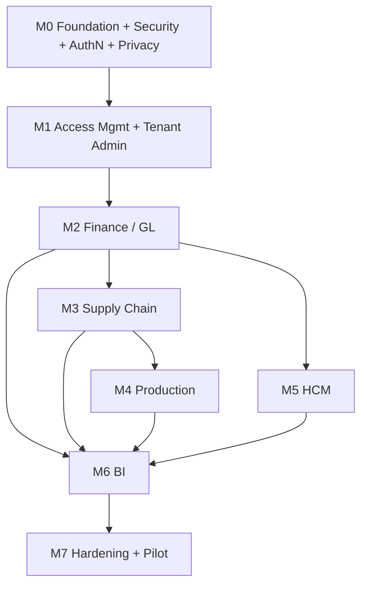

# 16 — Dependency Map

## Module dependencies

## Story-level dependencies (critical path in bold)
| Story | Depends on | Why |
|---|---|---|
| **US-019 RLS** | US-004, US-010 | Needs session + tenant context |
| **US-104/105 CI scanners** | US-006 | Pipeline must exist first |
| US-120 Email verification | US-010, email provider | Needs signup + mail |
| **US-110 PII register** | US-004, US-005 | Needs models/migrations |
| **US-111 Field encryption** | US-108, US-110 | Needs keys + classification |
| US-114 Subject access export | US-110 | Needs PII register to find data |
| **US-115 Erasure/anonymisation** | US-110, US-111, ADR-003 | Must preserve ledger |
| US-117 Sensitive-read audit | US-020, US-111 | Audit log + encrypted fields |
| US-107 Encryption at rest | Hosting decision (Gap G-06) | Platform-dependent |
| **M5 payroll** | US-111, US-117 (M0) | Payroll data is Sensitive-Personal |
| US-018 RBAC guard | US-011 | Needs token claims |
| **US-033 Balanced entry** | US-032 | Journal model |
| **US-047 Posting engine** | US-034, US-036 | Needs posted/immutable + periods |
| **US-055 GR + GL** | US-047, US-052, US-054 | Stock + posting + PO |
| US-060 Delivery + COGS | US-047, US-064, US-058 | Costing needed for COGS |
| US-065 Inv↔GL recon | US-055, US-060, US-064 | All inventory postings exist |
| US-073 Work order | US-070, US-052 | BOM + stock |
| US-076 WIP accounting | US-047, US-074 | Posting + issues |
| US-086 Payroll run | US-080, US-085, US-087 | Employees, components, rules |
| US-089 Payroll GL | US-047, US-086 | Posting + locked run |
| US-090 Exec dashboard | M2 complete | Needs ledger data |
| US-099 Billing | US-021, US-010 | Module flags + tenant |

## External dependencies
| Dependency | Needed by | Owner | Risk |
|---|---|---|---|
| Email provider (SMTP/API) | US-010, US-015 | DevOps | Low |
| Payment provider | US-099 | PO decision | Medium |
| Cloud hosting + managed SQL Server licence | M7 / beta | PO/Finance | **High (cost)** |
| PH statutory tables | US-087 | HR SME | Medium |
| PDF generation lib | US-088 | Dev | Low |
| Object storage | FR-FIN-16 | DevOps | Low |

## Technical constraints
- SQL Server Developer edition for dev only; production needs a licence or Azure SQL (see Gap G-02).
- Async driver (`aioodbc`) requires the ODBC Driver 18 in the Docker image.
